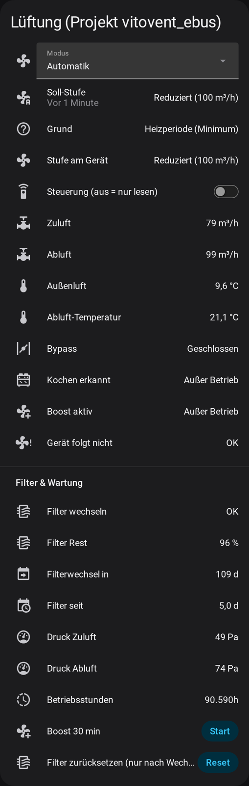
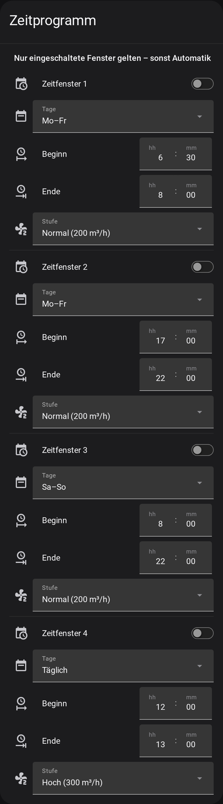

# Vitovent 300-W eBUS control for Home Assistant

> **Status: experimental.** Running daily on **one** unit only (Vitovent 300-W, software S1.05.04) since October 2026.
> Other units, software versions or values are **untested** – see [Tested on](#tested-on) before you turn on *Control*.

Home Assistant takes over the **Viessmann Vitovent 300-W** heat-recovery ventilation unit
(older series = Brink Renovent Excellent 300/400) via **eBUS** and ebusd – no wall panel, no cloud.

> **Disclaimer:** Independent hobby project – **not** made, endorsed, supported or checked by Viessmann or Brink and
> without any connection to them. Viessmann, Vitovent, Brink and Renovent are trademarks of their owners and are used only
> to describe compatibility. Use entirely **at your own risk** – no warranty and **no liability** for damage to the unit,
> the building (humidity, mould) or anything else. Check every setting on your own unit before relying on it.
> The software is provided free of charge "as is", without any warranty (see [LICENSE](LICENSE)); liability is
> excluded as far as the law permits. Mandatory statutory liability (e.g. for intent or gross negligence, or for
> injury to life, body or health) is not affected.

## Screenshot

 

*Running on the author's unit (German UI). Left: status, filter and maintenance – right: the time program.*

## Features

- **Automatic stage**: Reduced / Normal / High with a readable reason
  - **cooking detection** from the kitchen power (15-min mean, kettle and coffee machine are ignored, 60 min run-on)
  - bathroom humidity, room humidity and CO₂ boost
  - heating period = minimum flow all day (saves heat)
  - night and nobody-home = Reduced, vacation mode
  - optional summer night cooling (bypass)
  - **time program** like a heating/hot-water program: 4 windows, each daily / Mon–Fri / Sat–Sun / single weekday,
    start, end (over midnight possible) and stage – set directly on the device page or in a dashboard
  - optional weekly plan via a UI schedule helper (stage per time block)
  - 30-min boost script, fixed manual stages
  - **0.4.0:** switches *Humidity boost*, *CO₂ boost*, *Cooking boost* with adjustable limits (number entities, no
    need to open the options), switch *Time program* (windows only count – and the example card only shows them –
    while it is on), **Eco mode** with two extra stages *Eco* (e.g. 60 m³/h) and *Max* (e.g. 400 m³/h): the unit
    stage Reduced/High gets the matching air volume, written only when it has to change (at most every 10 min)
- **Optional second ESP32** with two temperature/humidity probes in supply and exhaust air → heat recovery
  efficiency and recovered heat, see [docs/SETUP.md](docs/SETUP.md#5-optional-supply-and-exhaust-air-sensors)
- **Monitoring**: warning when the unit does not follow the target stage for 10 min (or ebusd delivers nothing),
  values expire when ebusd stops sending, list of configured input sensors that are unavailable
- **Maintenance**: filter status, filter days and flow, **% remaining and estimated days until change**,
  operating hours, total air flow, supply/exhaust pressure, error memory, software version
- **Filter notification** once when the unit asks for new filters, plus a **filter reset** script
- Live values: air flows, fan speeds, extract/outdoor temperature, bypass, frost protection, fan status
- Setup and all sensors in the UI (config flow and options), English and German, one device with all entities
- Starts read-only (integration and YAML package): a **Control** switch decides whether HA writes anything to the unit
- A **repair notice** (Settings › Repairs) appears while the unit does not follow the target stage – no automation needed

## Installation

### HACS (recommended)

1. HACS › ⋮ › **Custom repositories** › add `https://github.com/quitkelvin/ha-vitovent-ebus`, type **Integration**.
2. Install **Vitovent 300-W (eBUS)**, restart Home Assistant.
3. Settings › Devices & services › **Add integration** › *Vitovent 300-W (eBUS)* › confirm the MQTT prefix
   (default `ebusd/Vitovent300W400`).
4. **Configure** (options): pick your kitchen power, bathroom humidity, CO₂, presence … sensors – all optional.
5. The integration starts **read only** after the first setup. When the values look right, turn on the switch **Control**.
   Its last state is kept across restarts (turn it off again to go back to read only).
   While it is off, *nothing* is written to the unit – including the filter reset.

Before that: eBUS adapter parallel to the unit's X1 terminal and ebusd with the
[pvyleta/ebusd-brink-hru](https://github.com/pvyleta/ebusd-brink-hru) config – see **[docs/SETUP.md](docs/SETUP.md)**.

### Alternative: YAML package

`packages/vitovent_ebus.yaml` contains the same logic as a plain Home Assistant package (no HACS needed),
example card in `dashboard/vitovent_card.yaml`. Since 0.4.1 it also starts **read only**: nothing is sent to the unit
until you turn on `input_boolean.vitovent_control` (*Vitovent Control*). Do not run both with control enabled at the same time.

Requirements: Home Assistant 2025.1 or newer, MQTT integration, ebusd with `--mqttjson`.

## Important

- **"Holiday" (50 m³/h) is not offered** – on the tested unit it ran in ConstantPWM and produced negative pressure.
  For less air, lower **Air volume Reduced** instead (integration 0.3.0, 50–400 m³/h): the unit stays in ConstantFlow.
  Example from the test unit: Reduced 60 m³/h with imbalance −10 → supply 50 / exhaust 60 m³/h.
- **Unit parameters (0.3.0):** number entities *Air volume Reduced / Normal / High* and *Imbalance (supply − exhaust)*
  are read from the unit every hour. They can only be written while the switch *Control* is on; values are
  clamped to the unit limits and read back. These are installer settings – note the old values before changing them.
- The YAML package never switches the unit off and never writes installer parameters.
- If an input sensor (kitchen power, humidity, CO₂) fails, its boost cannot trigger – see attribute `inputs_unavailable` of `sensor.vitovent_target_stage`.
- Ventilation affects humidity and the building fabric. The behaviour below is **not** a safety function – check the
  humidity in your rooms yourself, especially in the first weeks and after every change. See [LICENSE](LICENSE) (MIT, no warranty).

## Tested on

Only these combinations were run on a real unit. Anything else is untested – leave *Control* off there (read only).

| Item | Tested |
|---|---|
| Unit | Viessmann Vitovent 300-W, Brink software **S1.05.04**, eBUS slave `7c` (one unit) |
| Adapter / ebusd | eBUS Adapter Shield C6, ebusd with `Vitovent300W400` from pvyleta/ebusd-brink-hru |
| Stages written | Reduced / Normal / High (`Ventilatorbetrieb`). **Holiday is blocked** (negative pressure on the test unit) |
| Air volumes written | Reduced 60 and 100 m³/h, Normal 200 m³/h, High 300 m³/h (the unit reached only ~215 m³/h on High) |
| Imbalance | −10 and −20 (installer value – leave it unless you know why) |
| Filter reset | `ResetNotifications = Filter` |

The number entities allow the full unit range (50–400 m³/h); values outside the table above are untested.

## Failure behaviour

What happens when a part stops – and what was actually observed on the test unit:

| Failure | Expected behaviour | Observed |
|---|---|---|
| Home Assistant restart | unit keeps its last stage, HA re-sends after start | yes – short restarts (~20 s): stage kept |
| HA, MQTT or ebusd down for longer | a stage written via eBUS only holds for a few minutes, then the unit returns to its own stage and keeps ventilating; it is never switched off | **not systematically tested** |
| eBUS adapter offline | as above; values expire after 5 min / 2 h, *does not follow* warning after 10 min | not systematically tested |
| Input sensor unavailable | related boost cannot trigger, listed in `inputs_unavailable` | yes (design, attribute visible) |
| Wrong installer value written | clamped to unit limits and read back – but a valid wrong value stays until you change it | – |

Before relying on it: stop ebusd (or the adapter) for 15 min with *Control* on and check that the unit keeps
ventilating; note the installer values before changing any of them.

---

## Kurz auf Deutsch

Home Assistant steuert die ältere **Viessmann Vitovent 300-W** (baugleich Brink Renovent Excellent 400) allein über
eBUS – ohne Bedienteil und ohne Cloud. Das Paket kann:

- **Stufen automatisch wählen:** Kochen-Erkennung über den Küchenstrom, Bad- und Raumfeuchte, CO₂, Heizperiode mit Minimum, Nacht, Abwesenheit, Urlaub, Sommer-Nachtkühlung.
- **Zeitprogramm wie beim Warmwasser:** 4 Zeitfenster, jeweils täglich, Mo–Fr, Sa–So oder einzelner Wochentag, mit Beginn, Ende und Stufe. Optional zusätzlich ein Wochenplan über den Zeitplan-Helfer.
- **Überwachen:** Warnung, wenn das Gerät 10 Minuten lang nicht der Soll-Stufe folgt.
- **Wartung anzeigen:** Filter in % und Tage bis zum Wechsel, Betriebsstunden, Drücke, Fehlerspeicher.
- **Filter melden:** Push, wenn ein Wechsel fällig ist, dazu ein Skript zum Zurücksetzen.

**Einrichtung:** In HACS unter „Benutzerdefinierte Repositories“ diese Adresse als Typ *Integration* hinzufügen, installieren und HA neu starten. Danach die Integration „Vitovent 300-W (eBUS)“ hinzufügen und unter „Konfigurieren“ die eigenen Sensoren auswählen. Sie startet nur lesend; der Schalter „Steuerung“ schaltet das Schreiben ein. Das YAML-Paket startet ab 0.4.1 ebenfalls nur lesend (`input_boolean.vitovent_control`). Hardware und ebusd: [docs/SETUP.md](docs/SETUP.md).

**Status:** experimentell, läuft im Alltag an **einem** Gerät (Vitovent 300-W, Software S1.05.04). Andere Geräte, Software-Stände und Werte sind ungetestet – dort „Steuerung“ aus lassen (siehe *Tested on*). Ausfälle von HA/MQTT/ebusd über längere Zeit sind nicht systematisch getestet (siehe *Failure behaviour*); Raumfeuchte selbst im Blick behalten.

**Haftungsausschluss:** Unabhängiges Hobbyprojekt – **keine** Verbindung zu Viessmann oder Brink, nicht von ihnen geprüft oder unterstützt; Marken gehören ihren Inhabern. Nutzung **auf eigene Gefahr**; unentgeltlich und ohne Gewährleistung (siehe LICENSE), Haftung für Schäden an Gerät oder Gebäude (Feuchte, Schimmel) ausgeschlossen, soweit gesetzlich zulässig. Zwingende gesetzliche Haftung (z. B. bei Vorsatz, grober Fahrlässigkeit oder Verletzung von Leben, Körper, Gesundheit) bleibt unberührt. Alle Einstellungen am eigenen Gerät prüfen.

**Wichtig:** Die Stufe „Urlaub“ (50 m³/h) ist absichtlich gesperrt, weil sie am Gerät Unterdruck erzeugt hat. Für weniger Luft stattdessen die **Luftmenge Reduziert** senken (ab 0.3.0, 50–400 m³/h, Gerät bleibt in ConstantFlow), z. B. Reduziert 60 m³/h mit Ungleichgewicht −10 → Zuluft 50 / Abluft 60 m³/h. Luftmengen und Ungleichgewicht sind Installateur-Werte: nur mit Schalter „Steuerung“ schreibbar, vorher alte Werte notieren. Es gibt keine Gewährleistung.

## Credits

- [ebusd](https://github.com/john30/ebusd) by john30
- Brink/Vitovent message definitions by [pvyleta](https://github.com/pvyleta/ebusd-brink-hru) and
  [dstrigl](https://github.com/dstrigl/ebusd-config-brink-renovent-excellent-300)
